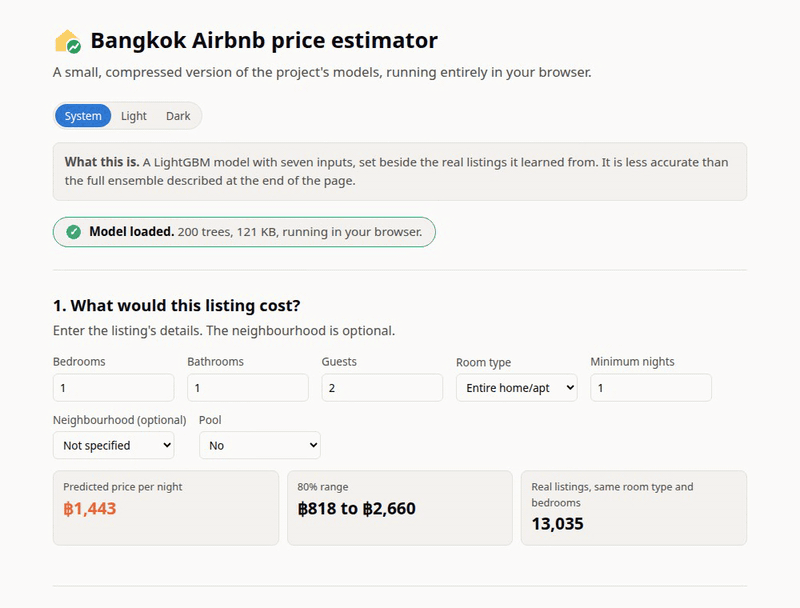
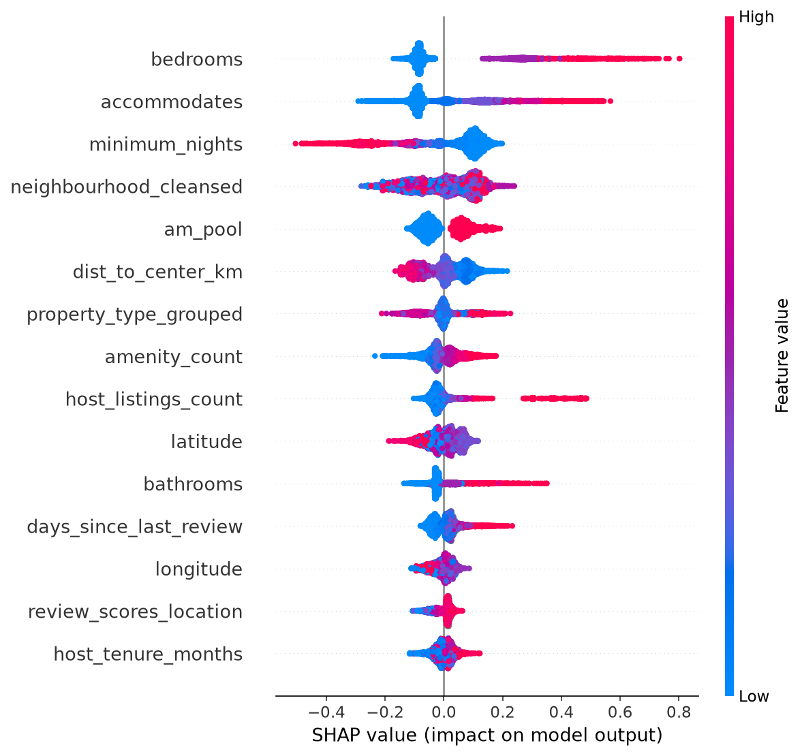
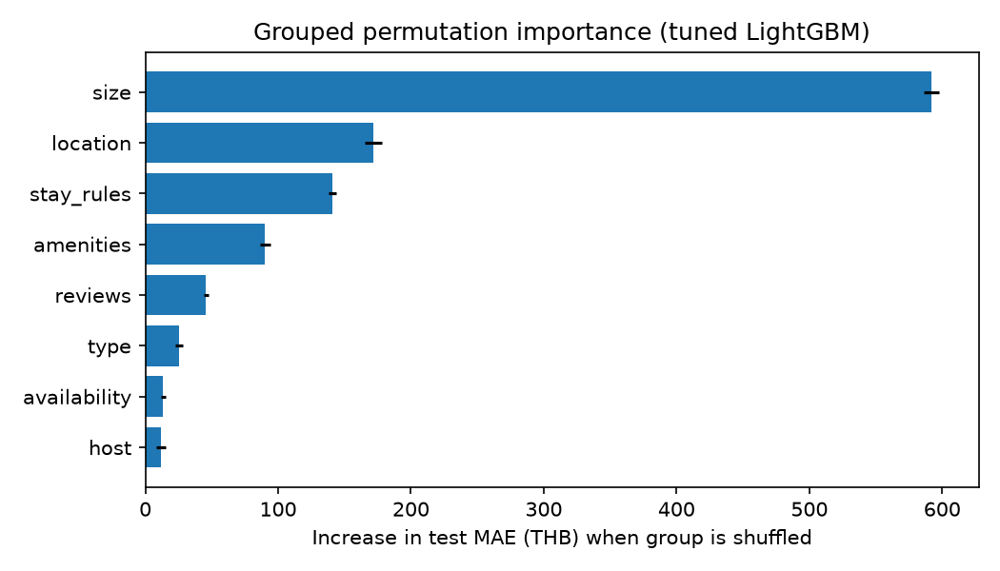
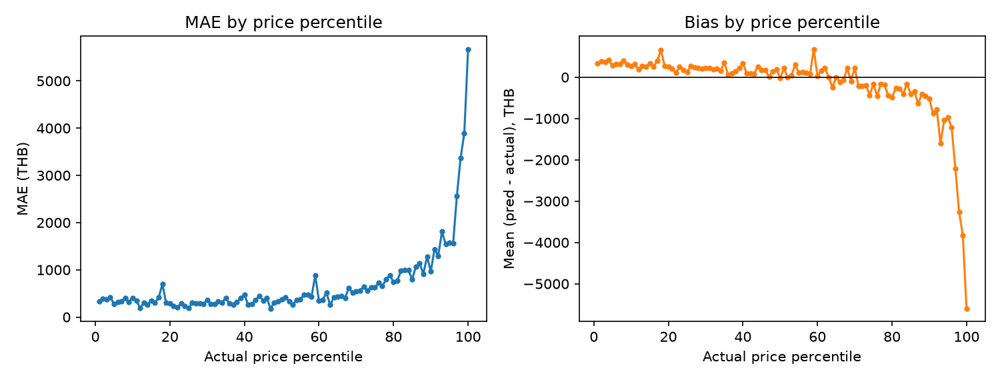
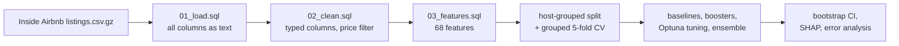

# Bangkok Airbnb Pricing

**[Live demo](https://t6523.github.io/bangkok-airbnb-pricing/)**

Predicts nightly Airbnb prices in Bangkok from listing features: DuckDB SQL does the cleaning and feature engineering, then LightGBM, XGBoost and CatBoost (tuned with Optuna) and a three-model ensemble are evaluated against a linear baseline.

**Stack:** Python 3.12 · DuckDB (SQL) · scikit-learn · LightGBM / XGBoost / CatBoost · Optuna · SHAP · Docker

<p align="center"></p>

## Highlights

- **Grouped split:** Train and test are split by `host_id` (`GroupShuffleSplit`, 80/20, seed 42), so no host appears on both sides. One host's listings are often near-copies in price so a random split would leak data.
- **Best model: ensemble of the three tuned boosters, test MAE 666 THB** (95% CI 599–737), against 804 THB (731–883) for linear regression, a paired-bootstrap difference of 138 THB (CI 53–203), about 17% lower.
- **Bootstrap confidence interval:** A host-level bootstrap (1,000 resamples of test hosts) puts a CI on every number. The three tuned boosters are statistically tied with each other.
- **Interpretation:** grouped permutation importance and SHAP on the test set. Listing size dominates while location, minimum-stay rules and amenities follow.

## Results

Test set: 5,437 listings from 1,426 held-out hosts. Prices in THB. Models predict `log(price)` and the output is `exp()`'d back.

| Model                           | Test MAE (THB) [95% CI] | CV MAE ± sd | Within 20% | R² (log) |
| ------------------------------- | ----------------------- | ----------- | ---------- | -------- |
| Constant (train median)         | 1,160 [1,056–1,265]     | 1,186 ± 64  | 26.2%      | −0.009   |
| Linear regression               | 804 [731–883]           | 885 ± 79    | 37.6%      | 0.527    |
| Random forest                   | 735 [649–832]           | 703 ± 40    | 44.0%      | 0.578    |
| LightGBM (tuned)                | 682 [605–764]           | 679 ± 32    | 46.2%      | 0.637    |
| XGBoost (tuned)                 | 674 [608–742]           | 684 ± 32    | 45.4%      | 0.647    |
| CatBoost (tuned)                | 671 [607–736]           | 680 ± 31    | 46.2%      | 0.654    |
| **Ensemble of the three tuned** | **666 [599–737]**       | 673 ± 32    | 46.8%      | 0.655    |

Within 20% is the share of listings predicted within 20% of the true price. CV is grouped 5-fold on the training hosts. CIs come from resampling test hosts (1,000 resamples).

<details>
<summary>All models, including untuned versions</summary>

| Model                                    | Test MAE (THB) [95% CI] | CV MAE ± sd | Within 20% | R² (log) |
| ---------------------------------------- | ----------------------- | ----------- | ---------- | -------- |
| Constant (train median)                  | 1,160 [1,056–1,265]     | 1,186 ± 64  | 26.2%      | −0.009   |
| Linear regression                        | 804 [731–883]           | 885 ± 79    | 37.6%      | 0.527    |
| Random forest                            | 735 [649–832]           | 703 ± 40    | 44.0%      | 0.578    |
| LightGBM                                 | 706 [616–815]           | 676 ± 34    | 45.6%      | 0.621    |
| XGBoost                                  | 698 [614–794]           | 683 ± 28    | 45.2%      | 0.625    |
| CatBoost                                 | 688 [618–758]           | 687 ± 34    | 44.8%      | 0.642    |
| LightGBM (tuned)                         | 682 [605–764]           | 679 ± 32    | 46.2%      | 0.637    |
| XGBoost (tuned)                          | 674 [608–742]           | 684 ± 32    | 45.4%      | 0.647    |
| CatBoost (tuned)                         | 671 [607–736]           | 680 ± 31    | 46.2%      | 0.654    |
| Ensemble of the four untuned tree models | 690 [607–781]           | 671 ± 34    | 46.1%      | 0.636    |
| Ensemble of the three tuned              | 666 [599–737]           | 673 ± 32    | 46.8%      | 0.655    |

Untuned boosters share one fixed budget (500 trees, learning rate 0.05). Optuna trials: LightGBM 40, XGBoost 40, CatBoost 31 (hit the 20-minute cap).

</details>

Paired bootstrap on MAE: difference in THB (first model minus second), same resampled hosts for both. Clear means the 95% CI excludes zero.

| Comparison                         | Difference | 95% CI    | Clear? |
| ---------------------------------- | ---------- | --------- | ------ |
| Linear regression − tuned ensemble | 138        | 53 to 203 | yes    |
| Random forest − tuned ensemble     | 69         | 36 to 111 | yes    |
| Tuned LightGBM − tuned ensemble    | 16         | 3 to 34   | yes    |
| Tuned XGBoost − tuned ensemble     | 8          | 1 to 15   | yes    |
| Tuned CatBoost − tuned ensemble    | 5          | −8 to 16  | no     |
| LightGBM − tuned LightGBM          | 24         | 1 to 56   | yes    |
| XGBoost − tuned XGBoost            | 23         | −3 to 62  | no     |
| CatBoost − tuned CatBoost          | 17         | 3 to 33   | yes    |

## What drives the price

Grouped permutation importance on the test set (tuned LightGBM). Each row is the MAE increase when that group of columns is shuffled together.

| Feature group                                         | Features | MAE increase (THB) |
| ----------------------------------------------------- | -------- | ------------------ |
| size (bedrooms, guests, beds, baths)                  | 7        | 592                |
| location (neighbourhood, lat/lon, distance to centre) | 4        | 172                |
| stay rules (minimum / maximum nights)                 | 2        | 141                |
| amenities                                             | 26       | 90                 |
| reviews                                               | 14       | 46                 |
| type (room, property)                                 | 2        | 25                 |
| availability                                          | 5        | 14                 |
| host                                                  | 8        | 12                 |

SHAP's top six features are `bedrooms`, `accommodates`, `minimum_nights`, `neighbourhood_cleansed`, `am_pool` and `dist_to_center_km`. `minimum_nights` ranks third because listings with long minimums (30 nights and up) are priced as monthly rentals, so the model pushes their nightly price down. Association only, not a lever for hosts.

<p align="center"></p>

## Where the model fails

Tuned ensemble, test set:

| Segment                           | Listings | MAE (THB) | Within 20% |
| --------------------------------- | -------- | --------- | ---------- |
| Entire home / apartment           | 3,474    | 672       | 52.1%      |
| Private room                      | 1,846    | 657       | 38.2%      |
| Hotel room                        | 59       | 950       | 20.3%      |
| Shared room                       | 58       | 307       | 24.1%      |
| Price third: low (< 1,218)        | 1,826    | 325       | 40.7%      |
| Price third: middle (1,218–2,091) | 1,810    | 377       | 59.3%      |
| Price third: high (> 2,091)       | 1,801    | 1,303     | 40.3%      |

- **Expensive tail:** the top price-percentile bin has an MAE of 5,669 THB, against 962 THB at the 90th. Cheap listings are over-predicted and expensive ones under-predicted (`figures/error_by_percentile.png`).
- **Largest errors:** all 20 are under-predictions of listings priced 9,000 to 18,500 THB, mostly small units with few or no reviews and high availability. They look like very high asking prices nobody has booked. I read those rows by eye, there's no test behind that.
- **Small segments:** hotel and shared rooms have about 58 test listings each, so those numbers are noisy.

<p align="center">


</p>

## How it works



**Data:** Inside Airbnb Bangkok `listings.csv.gz`, scraped 2026-09-22 (CC BY 4.0). 30,922 raw listings, 28,092 modelled. Dropped: no price, price outside 361 to 18,541 THB (1st to 99th percentile, a placeholder scope), room types outside the four standard ones, missing `accommodates`. Eight columns are fully empty in this snapshot (`host_since`, host response time and rate, acceptance rate, `host_total_listings_count`, `bathrooms`, `instant_bookable`, `license`), so tenure comes from `hosts_time_as_host_*` and bathrooms are parsed from `bathrooms_text`. Price-derived columns (`price_quote_*`, `estimated_*`) are excluded to avoid leakage.

**SQL:** the raw file loads as text and cleaning casts with `TRY_CAST`. `03_features.sql` uses CTEs, window functions (`COUNT() OVER`, `PERCENT_RANK()`), an `UNNEST` of the amenities JSON, a haversine distance to Siam and a `PIVOT` for the 25 amenity flags (present in 3 to 97% of listings, closest to 50%).

**Models:** everything predicts `log(price)`. Baselines are a constant (train median) and a linear regression. Trees are a random forest, LightGBM, XGBoost and CatBoost, each with fixed settings and then tuned with Optuna (TPE, seed 42, grouped-CV RMSE on log price, 20-minute cap per model). The ensemble is the geometric mean of the three tuned boosters' predictions.

## Quickstart

Linux, macOS or WSL2, Python 3.12. On Windows without WSL, run the commands from the Makefile in order (`make -n all` prints them).

```bash
make setup      # create .venv and install pinned requirements
make all        # download data, build tables, split, tune, evaluate, bootstrap, explain, error analysis
```

`make all` writes `results/` and `figures/` (not committed, the tables above are the record). Tuning is capped at 20 minutes per model. Single stages: `make data`, `make sql`, `make split`, `make tune`, `make evaluate`, `make bootstrap`, `make explain`, `make errors`. Close any DuckDB shell on `airbnb.duckdb` first, it allows one writer.

### Docker

```bash
docker build -t bangkok-airbnb-pricing .
docker run --rm -v "$PWD/data:/app/data" -v "$PWD/results:/app/results" -v "$PWD/figures:/app/figures" bangkok-airbnb-pricing
```

Runs `make all` inside the container. The mounts keep the data, results and figures on your machine. The image is 2.5 GB. On a Linux host the mounted outputs are owned by root. For a single stage, add the command, for example `... bangkok-airbnb-pricing make PY=python split`.

## Project structure

```
Dockerfile                image that runs the pipeline (make all)
config.py                 paths and constants (seed 42, price scope, split sizes, reference point)
scripts/download_data.py  fetch the three raw files from Inside Airbnb
scripts/run_sql.py        run SQL files, filling ${placeholders} from config.py
sql/01_load.sql           raw text tables
sql/02_clean.sql          typed, filtered clean_listings
sql/03_features.sql       features table and amenity flags, exported to parquet
src/airbnb_pricing/
  split.py                host-grouped train/test split and CV folds
  baselines.py            constant and linear baselines, feature preprocessing
  models.py               random forest, LightGBM, XGBoost, CatBoost, tuned variants
  tune.py                 Optuna search (lgbm | xgb | cat)
  evaluate.py             metrics, CV and test, tuned ensembles
  bootstrap.py            host-level bootstrap CIs and paired differences
  explain.py              grouped permutation importance and SHAP
  error_analysis.py       segment metrics and residual plots
```

## Limitations and future work

- **Single snapshot:** one scrape, no temporal validation.
- **Asking prices:** `price` is what hosts ask, not what guests paid. The price scope is a percentile placeholder, not a defended choice.
- **Light tuning:** fixed 500 trees, no early stopping, random forest untuned.
- **No tests or CI:** the only checks are assertions in the pipeline, for example no host on both sides of the split.
- **Not done:** coordinate bounds check against the neighbourhood polygons, prediction intervals, distance to the nearest BTS/MRT station, listing text.
- **Associations only:** importance and SHAP describe the model, not causal effects.

## Acknowledgements

Data: [Inside Airbnb](https://insideairbnb.com/get-the-data/), CC BY 4.0. SHAP: Lundberg & Lee, *A Unified Approach to Interpreting Model Predictions* (2017). Libraries: scikit-learn, LightGBM, XGBoost, CatBoost, Optuna, DuckDB.

## License

MIT, see [LICENSE](LICENSE).
